<div align="center">

# ZCode Mobile

**ZCode 桌面端的非官方 Android 客户端**

扫码连接电脑 · 无外壳浏览工作区 · 任务完成即提醒

[](LICENSE)
[](https://www.android.com)
[-00B8D4)](#系统要求)
[](https://kotlinlang.org)

[功能特性](#功能特性) · [下载安装](#下载安装) · [快速上手](#快速上手) · [常见问题](#常见问题) · [从源码构建](#从源码构建) · [参与贡献](#参与贡献)

</div>

---

## 简介

在 Android 手机上查看电脑里的 ZCode 工作区、继续任务会话，并在**任务完成、出错或需要确认时收到系统通知**。

第一次用相机扫描桌面端的连接码（也支持从相册选取二维码截图），绑定成功后打开 App 即直达这台电脑的工作区。工作区与账号授权由 ZCode 官方提供，本客户端在手机端补齐了扫码、绑定记忆、工具栏与任务提醒。

> ⚠️ **非官方项目** —— 本项目与 ZCode / 智谱 AI 无任何隶属关系，仅供个人学习研究。详见[免责声明](#免责声明)。

| 手机上的任务列表 | 打开已有任务 |
| --- | --- |
| 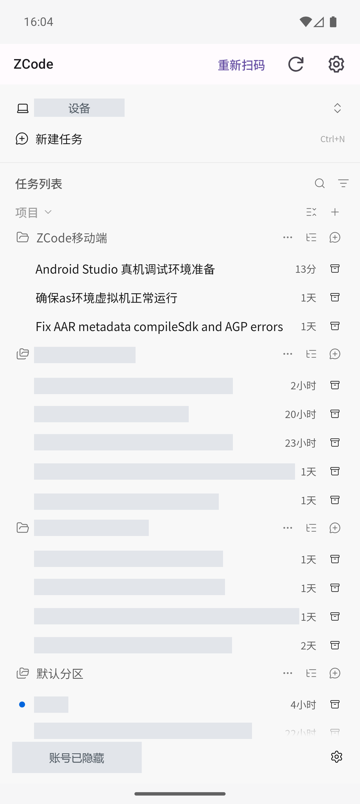 | 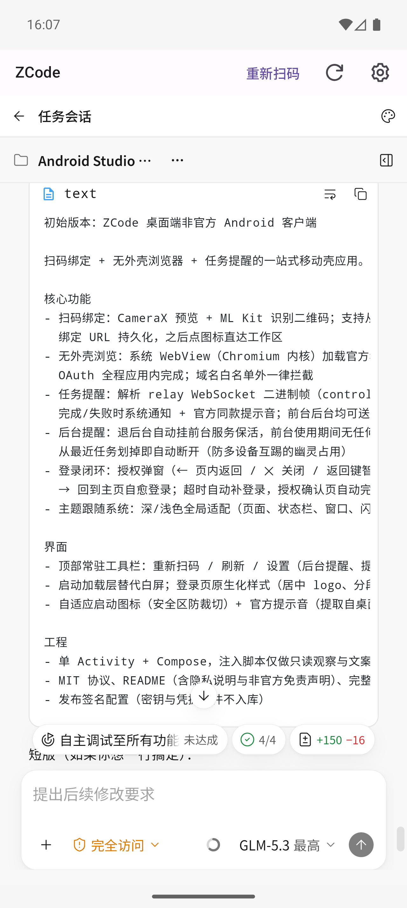 |

## 功能特性

| | 特性 | 说明 |
|---|---|---|
| 📷 | **扫码绑定** | 相机扫描桌面端连接码；支持从相册选取二维码截图识别 |
| ⚡ | **免扫码直达** | 绑定一次，之后打开 App 直接连上电脑 |
| 🌐 | **无外壳浏览** | 系统 WebView（Chromium 内核）加载官方移动页，无地址栏、无标签页，OAuth 全程应用内完成 |
| 🔔 | **任务提醒** | 工作区连接期间，任务完成、出错或需要确认时会发出系统通知 |
| 🔄 | **后台保持** | 切后台自动挂前台服务保活；前台使用期间无任何常驻通知 |
| 🌓 | **主题跟随系统** | 深色 / 浅色全局一致（页面、状态栏、窗口、闪屏） |
| 🔒 | **隐私优先** | 无广告、无统计 SDK；网页导航限制在 ZCode 与授权域名白名单内 |

## 系统要求

| 项目 | 要求 |
| --- | --- |
| 手机系统 | Android 12（API 31）及以上 |
| 通知 | Android 13+ 需允许通知权限（首启时询问） |
| 电脑端 | ZCode 桌面端已登录并开启「移动端远程控制」 |
| 网络 | 手机与电脑均可访问互联网；同一 ZCode 账号 |

## 下载安装

- **Release 版**：从 [Releases](../../releases) 下载对应版本的 APK（本版为 `ZCodeMobile-v1.0.1-release.apk`），在手机上打开即可安装或覆盖升级。
- **自行构建**：见下方[从源码构建](#从源码构建)。

## 快速上手

### 1. 连接电脑

1. 电脑端打开 ZCode「移动端远程控制」面板，等待出现「等待手机连接」二维码。
2. 手机打开 ZCode Mobile，将二维码放入取景框；二维码已保存在手机上时，点「从相册选择二维码」选中截图即可。
3. 识别成功后自动保存绑定并进入工作区。

| 首次使用相机 | 对准电脑上的二维码 | 从相册选取截图 |
| --- | --- | --- |
| 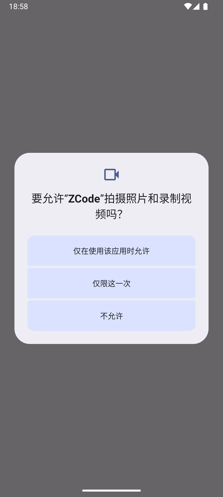 | 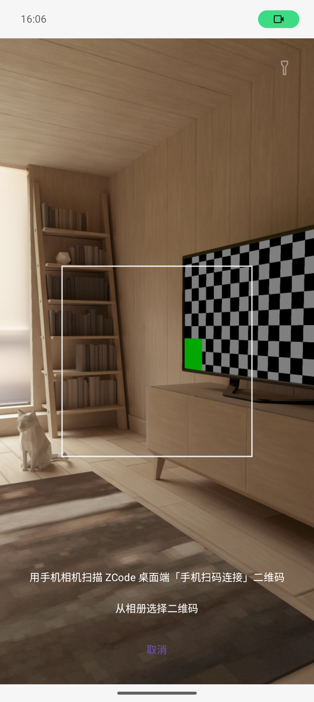 | 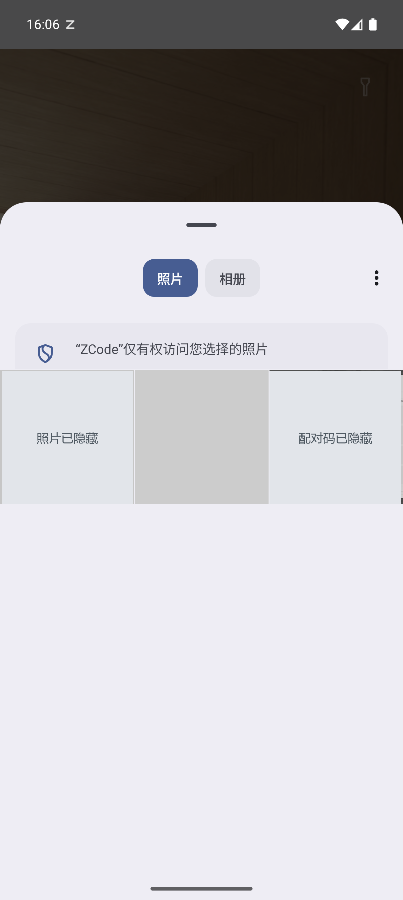 |

> 已有绑定时，从扫码页点「取消」可返回原工作区；连接其他电脑点顶部「重新扫码」。

### 2. 登录授权

选择与桌面账号一致的「中国」或「全球」区域，点「登录」，在授权窗口输入手机号与短信验证码；确认授权页核对账号与权限后点「继续」，成功后自动回到工作区。

| 选择账号区域 | 手机号登录 | 确认授权 |
| --- | --- | --- |
| 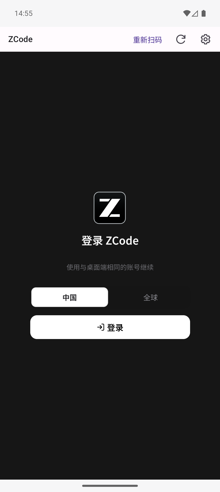 | 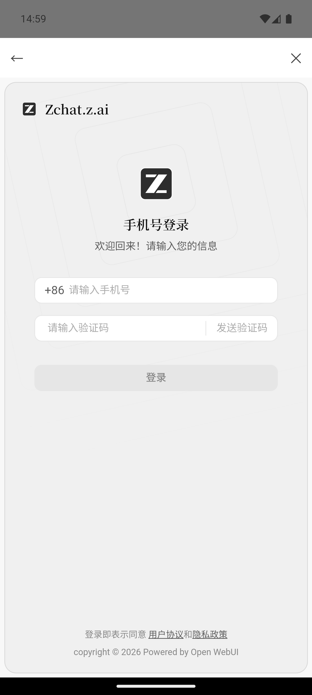 | 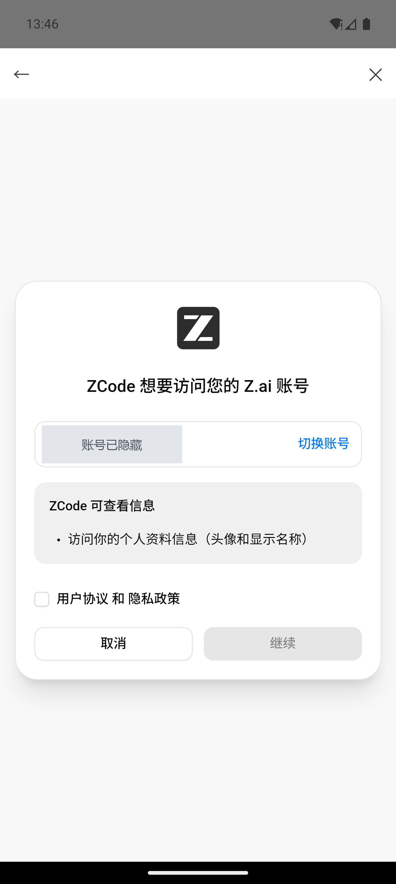 |

### 3. 工作区与任务

- **浏览任务**：按项目查看任务标题与更新时间；用搜索或视图菜单切换「按项目 / 按分组 / 最近更新 / 按未读」。
- **继续会话**：点任务标题阅读回复，在底部输入后续要求。
- **发起任务**：点「新建任务」，选择项目、填写要求后发送；发送前可切换确认模式与模型。

| 任务列表的视图菜单 | 发送前选择确认模式 |
| --- | --- |
| 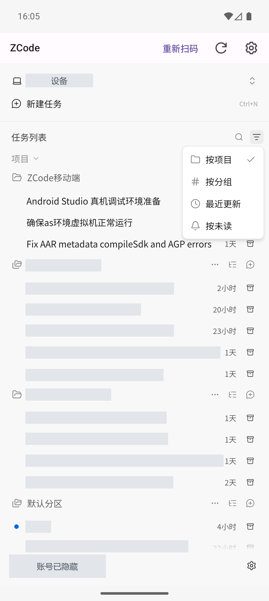 | 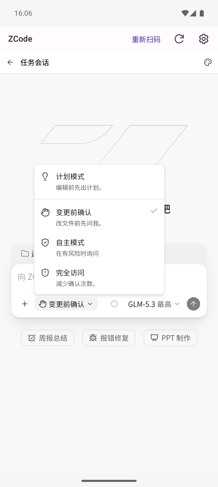 |

| 浅色 | 深色 |
| --- | --- |
| 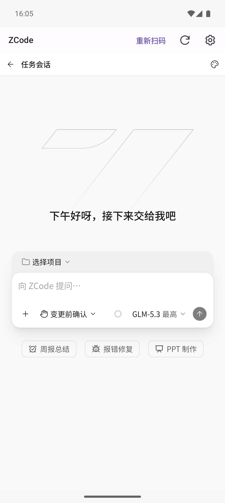 | 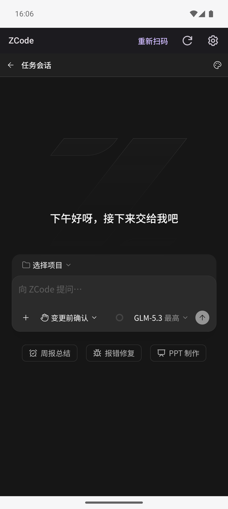 |

**快捷操作**：顶部工具栏提供 ⟳ 刷新、⚙ 设置（后台提醒 / 提醒声音）、重新扫码；在页面内容上**长按**也能唤出快捷菜单。

| 长按打开快捷菜单 | 设置后台提醒和声音 |
| --- | --- |
| 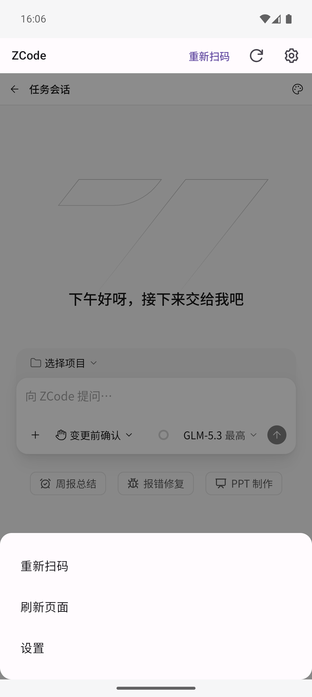 | 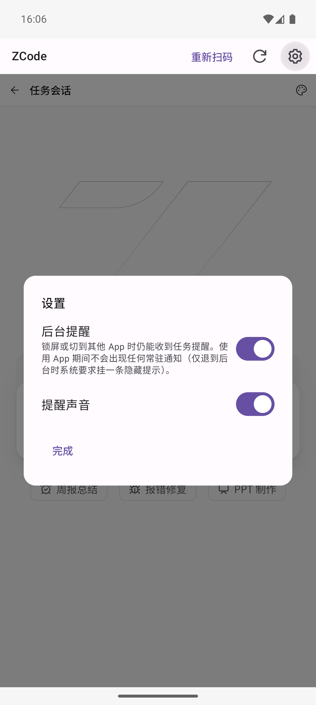 |

### 4. 后台通知

点任务完成或出错的通知，会打开对应的任务会话。不同任务的通知可以分别点开。对于未提供任务标识且无法匹配的提醒，App 会显示该条消息的详情。

Android 13+ 首次启动时允许通知权限。连接期间任务事件会转为 Android 通知；**后台提醒**与**提醒声音**默认开启，可在 ⚙ 设置中调整。切到后台后通知栏会出现一条静默的「ZCode 连接保持中」，回到 App 自动收起；从最近任务划掉 App 即结束连接。

**华为手机短时间能收提醒，切走较久后需要重连**：在 ZCode 的 ⚙ 设置中点「打开 ZCode 系统应用信息」，进入「耗电详情 → 启动管理」，关闭「自动管理」，打开「允许后台活动」并确定。菜单位置不同的机型可在系统设置中搜索「应用启动管理」，找到 ZCode。系统清理应用进程后，工作区连接会随之断开。[华为后台运行说明](https://consumer.huawei.com/cn/support/content/zh-cn00428704/)

| 首次允许通知 | 任务完成时 | 切到后台后 |
| --- | --- | --- |
| 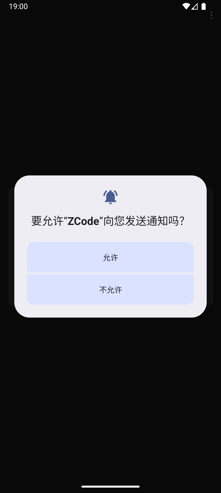 | 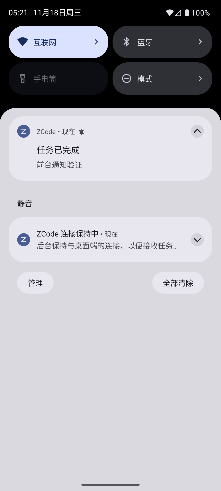 | 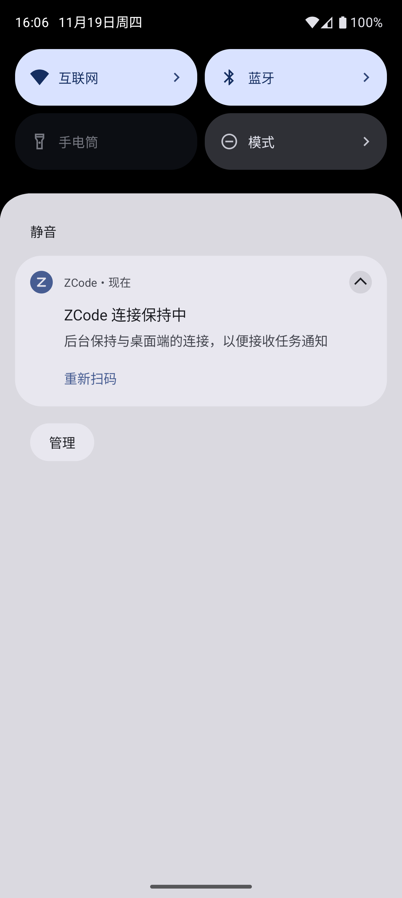 |

## 常见问题

| 遇到的情况 | 可以怎么做 |
| --- | --- |
| 相机权限没开，或一直扫不到 | 点「从相册选择二维码」，选桌面端生成的**完整**二维码截图（保留四周留白） |
| 「发送验证码」是灰色的 | 核对账号区域与手机号位数（中国区 11 位，输入框已带 +86） |
| 授权窗口加载失败 | 点「重新加载」；刚切换 VPN / 网络时等稳定后重试 |
| 显示 `OAuth flow expired` | 回到登录页重新发起一次授权即可 |
| 换手机后提示电脑离线 | 同一配对一次只允许一个手机页面：关闭旧设备上的 App → 电脑端重开「手机扫码连接」→ 新设备重新连接 |
| 后台收不到提醒 | 检查系统通知权限、App 内「后台提醒」开关、桌面端在线状态；锁屏连接受系统省电策略影响 |

## 隐私与安全

- 相机仅用于原生扫码，识别在设备本地完成；相册导入只访问所选图片
- 绑定地址与提醒偏好保存在应用私有目录；登录状态由本机 WebView 管理
- 网页导航限制在 ZCode 与授权域名白名单；网页发起的相机 / 麦克风 / 定位权限一律拒绝
- **不集成广告、统计或任何第三方追踪 SDK**

## 已知限制

- 官方服务端 OAuth 流程窗口约 60 秒，超时后需重新发起一次授权（客户端已自动补登录）
- relay 单页面规则：同一配对同时只能一个手机页面在线，多设备互开会被踢下线（官方行为）
- App 内嵌页面不支持长按选择文本（长按已用作快捷菜单）

## 从源码构建

**环境要求**：JDK 17 或 Android Studio 自带 JBR；Android SDK Platform 34。

```sh
# Windows (PowerShell)
.\gradlew.bat assembleDebug        # 产物位于 app/build/outputs/apk/debug/
.\gradlew.bat installDebug         # 构建并安装到已连接设备

# macOS / Linux
sh ./gradlew assembleDebug
```

**发布签名**：在仓库根目录放置 `key.properties`（`storeFile` / `storePassword` / `keyAlias` / `keyPassword`）与对应密钥库，运行 `assembleRelease`。安装包位于 `app/build/outputs/apk/release/`，文件名格式为 `ZCodeMobile-v<版本号>-release.apk`。密钥文件已被 `.gitignore` 排除，请妥善备份——**更换密钥将导致老用户无法覆盖升级**。

架构设计、WebView 与通知实现、调试与排障见[开发文档](docs/README.md)。

## 路线图

- [x] 扫码绑定 + 相册选码
- [x] 任务通知（提示音 + 系统通知 + 后台保活）
- [x] 登录闭环（应用内 OAuth + 超时自动补登录）
- [x] 深浅色主题跟随系统
- [ ] GitHub Actions 自动构建（打 tag 出 Release）
- [ ] 多设备绑定管理
- [ ] Wear OS 通知伴侣

## 参与贡献

欢迎 Issue 与 PR：

1. Fork 仓库并创建特性分支（`feat/xxx`、`fix/xxx`）
2. 改动请保持与现有代码风格一致；涉及行为变更请更新 [docs/README.md](docs/README.md)
3. 提交前确保 `assembleDebug` 构建通过
4. PR 请描述改动目的与验证方式

## 免责声明

本项目是 ZCode 桌面端「手机扫码连接」功能的**非官方**第三方客户端，与 ZCode / 智谱 AI 无任何隶属关系。「ZCode」名称及相关商标归其所有者所有。使用本项目访问的服务须遵守 ZCode 官方服务条款；因使用本项目产生的任何后果由使用者自行承担。

## 许可证

本项目代码以 [MIT License](LICENSE) 开源。

## 致谢

- [ZCode](https://zcode.z.ai) —— 优秀的桌面端 AI 编码工具
- [Codex](https://openai.com/codex) —— 本项目约一半的 Bug 由它修复 🤖
- 所有为本项目提出建议与反馈的用户
